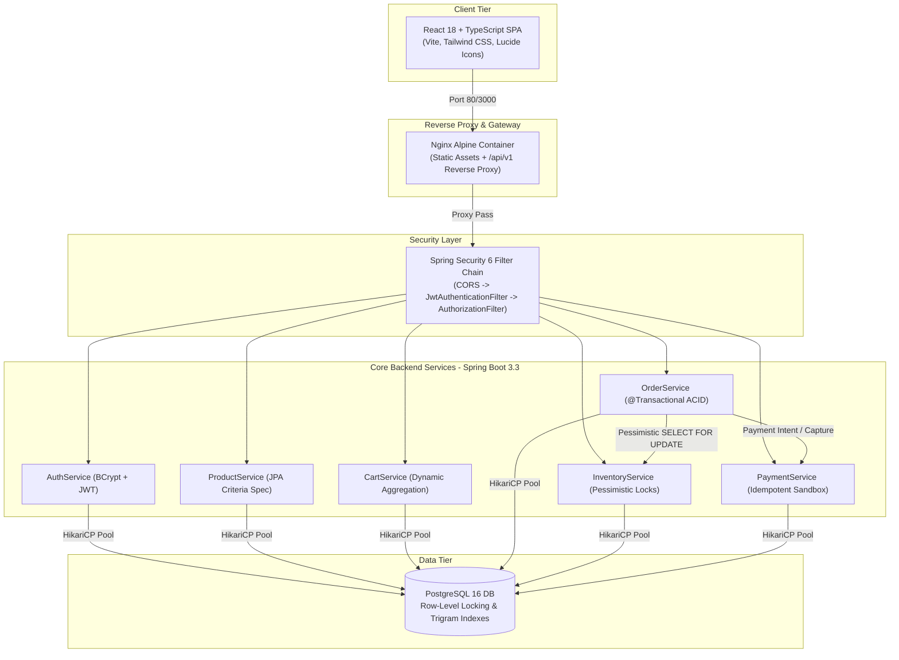

# ShopSphere — Enterprise E-Commerce & Order Management Platform 🛒

ShopSphere is a production-grade, full-stack e-commerce and order management platform built with **Java 17, Spring Boot 3.3, Spring Security 6, Spring Data JPA, PostgreSQL 16, React 18, TypeScript, and Docker**.

Designed with enterprise distributed systems principles, ShopSphere addresses real-world challenges: **preventing inventory overselling under high concurrency, guaranteeing financial atomicity (ACID), tokenized sandbox payments (PCI-DSS compliance), and immutable historical financial snapshots**.

---

## 1. System Architecture



---

## 2. Technology Stack

| Layer | Technologies |
| :--- | :--- |
| **Backend Core** | Java 17, Spring Boot 3.3.0, Spring Web, Spring Security 6, Spring Data JPA |
| **Database & ORM**| PostgreSQL 16, Hibernate 6, HikariCP Connection Pool, Flyway Migrations |
| **Security & IAM** | JSON Web Tokens (JJWT 0.12.5), BCrypt Password Hashing, RBAC (`ROLE_CUSTOMER`, `ROLE_ADMIN`) |
| **Frontend** | React 18, TypeScript, Vite, Tailwind CSS, Axios, Lucide React Icons |
| **Containerization**| Docker, Docker Compose, Multi-stage builds, Alpine Linux, Nginx |
| **Testing** | JUnit 5, Mockito, Spring Boot Test, H2 in-memory profile |
| **API Docs** | SpringDoc OpenAPI 3, Swagger UI (`/swagger-ui.html`) |

---

## 3. Key Architectural Engineering Patterns

### 3.1 Preventing Overselling (Concurrency Control)
When multiple customers attempt to purchase the last unit of a product concurrently:
1. **Row-Level Pessimistic Locking (`SELECT FOR UPDATE`):** Checkout issues `productRepository.findByIdWithPessimisticLock(productId)`. PostgreSQL locks the exact row, forcing concurrent checkout threads to wait sequentially until the transaction commits or rolls back.
2. **Double-Check Validation:** The service validates `stockQuantity >= requestedQuantity` under lock. If stock is exhausted, it throws `InsufficientStockException` and aborts.
3. **Database Check Constraint:** A bedrock constraint `CHECK (stock_quantity >= 0)` ensures negative inventory can never exist in PostgreSQL.

### 3.2 Double-Entry Inventory Audit Trail
Stock is never mutated without an audit record. Every delta ($+$ or $-$) writes an immutable record to `inventory_logs` with `change_type` (`RESTOCK`, `ORDER_DEDUCTION`, `CANCELLATION_RESTORE`, `MANUAL_ADJUSTMENT`), `quantity_change`, `resulting_quantity`, and `reference_id`.

### 3.3 Historical Price & Address Snapshots
- `OrderItem` explicitly copies `unit_price`, `product_name`, and `product_sku` at the millisecond of purchase. Future price changes in the product catalogue will never mutate historical order totals.
- `Order` serializes the delivery address as a `JSONB` snapshot, ensuring customer profile address changes do not alter past shipment records.

### 3.4 Payment Idempotency & PCI-DSS Compliance
- **Zero Raw Card Storage:** Card numbers and CVVs never touch our backend database. The frontend interacts with a simulated tokenized terminal.
- **Idempotency Keys:** Every checkout request generates an `Idempotency-Key` (UUID). Network retries or rapid double-clicks return the existing order safely without duplicate billing.

---

## 4. Default Demonstration Accounts

| Persona | Email | Password | Role |
| :--- | :--- | :--- | :--- |
| **Store Administrator** | `admin@shopsphere.com` | `Admin@123` | Full access to Admin Console, order fulfillment, restock alarms |
| **Standard Customer** | `customer@shopsphere.com` | `Admin@123` | Browsing, cart management, checkout, test payments, order tracking |

*(Both login screens include one-click demo fill buttons!)*

---

## 5. Quick Start Runbook

### Option A: Complete Multi-Container Launch via Docker Compose (Recommended)
Clone the repository and run:
```bash
docker-compose up --build -d
```
Services will initialize:
- **Frontend SPA (Nginx):** [http://localhost:3000](http://localhost:3000) or [http://localhost](http://localhost)
- **Backend REST API:** [http://localhost:8080/api/v1](http://localhost:8080/api/v1)
- **Interactive Swagger UI:** [http://localhost:8080/api/v1/swagger-ui.html](http://localhost:8080/api/v1/swagger-ui.html)
- **PostgreSQL Database:** `localhost:5432` (`shopsphere` / `shopsphere_user` / `shopsphere_pass`)

---

### Option B: Local Native Development

#### 1. Start PostgreSQL
```bash
docker run --name shopsphere-postgres -e POSTGRES_DB=shopsphere -e POSTGRES_USER=shopsphere_user -e POSTGRES_PASSWORD=shopsphere_pass -p 5432:5432 -v $(pwd)/docker/postgres/init.sql:/docker-entrypoint-initdb.d/01-init.sql -d postgres:16-alpine
```

#### 2. Start Spring Boot Backend
```bash
cd backend
mvn clean spring-boot:run
```

#### 3. Start React Frontend
```bash
cd frontend
npm install
npm run dev
```
Open [http://localhost:5173](http://localhost:5173).

---

## 6. REST API Reference

| Domain | Method | Endpoint | Description |
| :--- | :--- | :--- | :--- |
| **Auth** | `POST` | `/api/v1/auth/register` | Register new customer |
| **Auth** | `POST` | `/api/v1/auth/login` | Authenticate and obtain JWT Bearer |
| **Auth** | `GET` | `/api/v1/auth/me` | Fetch authenticated session claims |
| **Catalogue** | `GET` | `/api/v1/products` | Multi-facet search, price filter & pagination |
| **Catalogue** | `GET` | `/api/v1/products/slug/{slug}` | Product details by SEO slug |
| **Cart** | `GET` | `/api/v1/cart` | Retrieve user active shopping cart |
| **Cart** | `POST` | `/api/v1/cart/items` | Add product to cart with live stock check |
| **Cart** | `PUT` | `/api/v1/cart/items/{id}` | Update line item quantity |
| **Orders** | `POST` | `/api/v1/orders/checkout` | Atomic checkout with pessimistic lock |
| **Orders** | `GET` | `/api/v1/orders` | Customer order history |
| **Orders** | `POST` | `/api/v1/orders/{no}/cancel` | Cancel order & restore inventory |
| **Payments** | `POST` | `/api/v1/payments/create-intent`| Create payment intent reference |
| **Payments** | `POST` | `/api/v1/payments/confirm` | Confirm sandbox card (SUCCESS/DECLINE) |
| **Admin** | `GET` | `/api/v1/admin/orders` | View platform orders |
| **Admin** | `PATCH`| `/api/v1/admin/orders/{no}/status` | Update fulfillment status |
| **Admin** | `GET` | `/api/v1/admin/inventory/low-stock` | Low stock SKU threshold alarms |
| **Admin** | `POST` | `/api/v1/admin/inventory/restock` | Restock SKU with audit justification |
