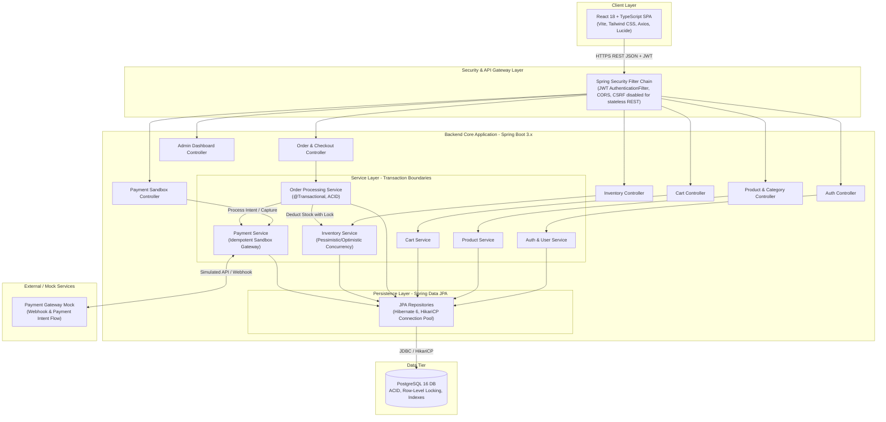

# ShopSphere — Architecture & System Design Document

## 1. Executive Summary
ShopSphere is a robust, production-grade enterprise e-commerce platform designed with Spring Boot 3, PostgreSQL, React (TypeScript), and Docker. This document serves as the high-level architecture blueprint and system specification.

---

## 2. System Architecture

---

## 3. Bounded Contexts & Domain Breakdown

| Domain Module | Primary Responsibilities | Key Entities |
| :--- | :--- | :--- |
| **Identity & Access Management (IAM)** | User registration, password encryption (BCrypt), JWT token issuance/validation, Role-Based Access Control (`ROLE_CUSTOMER`, `ROLE_ADMIN`). | `User`, `Role`, `Address` |
| **Catalog & Category** | Product listings, category hierarchical taxonomy, pricing, SKU management, search & multi-facet filtering. | `Product`, `Category` |
| **Cart Management** | Active customer carts, cart item quantity management, session-persistent or user-bound cart calculation. | `Cart`, `CartItem` |
| **Order & Checkout** | Atomic order creation, address snapshots, line items, status machine (`PENDING`, `PAID`, `SHIPPED`, `DELIVERED`, `CANCELLED`). | `Order`, `OrderItem`, `OrderStatus` |
| **Inventory & Concurrency** | Real-time stock counts, reserved stock, preventing overselling via row-level pessimistic locking (`PESSIMISTIC_WRITE`). | `Inventory` (or embedded stock in `Product`), `StockAuditLog` |
| **Payment Gateway Sandbox** | Payment intent generation, simulated card/UPI confirmation, webhook callbacks, idempotency guarantees. | `Payment`, `PaymentStatus` |

---

## 4. Key Architectural Decisions & Concurrency Strategies

### 4.1 Preventing Overselling (Concurrency Control)
When multiple customers purchase the last remaining unit of a hot product concurrently:
- **The Problem:** Two transactions read `stock = 1` simultaneously, both validate stock availability, and both write `stock = 0`, leading to negative inventory (Lost Update anomaly).
- **The Solution:** 
  1. **Pessimistic Locking (`SELECT FOR UPDATE`)**: At the moment of order processing, the inventory record for the product is locked using JPA's `LockModeType.PESSIMISTIC_WRITE`. Concurrent transactions waiting to purchase the same SKU must wait until the transaction commits or rolls back.
  2. **Atomic DB Check Constraint**: `CHECK (stock_quantity >= 0)` at the PostgreSQL database level as a failsafe guarantee against any application-level regression.

### 4.2 Payment Idempotency & Security
- **No Card Data Stored:** Strictly conform to PCI-DSS principles. Card details never touch our application server. The frontend interacts with the payment provider / sandbox token endpoint to receive a token/nonce.
- **Idempotency Keys:** Every checkout payment attempt includes an `Idempotency-Key` (UUID) to prevent double charges if the customer double clicks or network timeouts cause retries.
