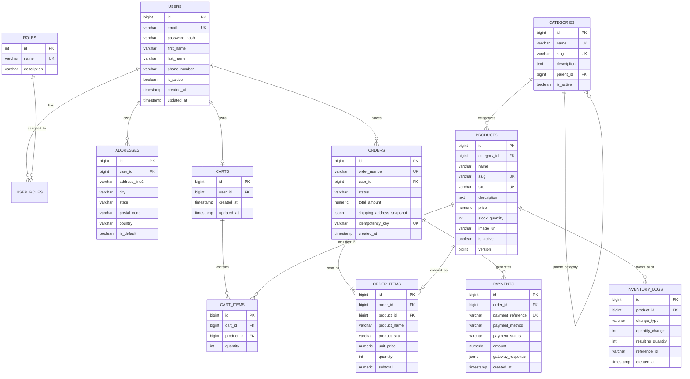

# ShopSphere — Database Schema & Data Modeling

## 1. Entity-Relationship Diagram (ERD)

## 2. Key Relational Decisions & Patterns

### 2.1 The Historical Price Snapshot Pattern
- **Problem:** If a product was bought at \$100, and next week the store increases the price to \$150, the past order record must still show \$100!
- **Solution:** `order_items` stores copies of `unit_price`, `product_name`, and `product_sku` at the exact millisecond of checkout. It does **not** rely on querying `products.price` for past orders.

### 2.2 Frozen Address Snapshot (`JSONB`)
- If the customer changes their default shipping address next month, past delivered packages must preserve the exact physical address where the package was originally shipped. We capture `shipping_address_snapshot` as immutable JSONB on the `orders` table.

### 2.3 Cascades and Delete Safety
- `products.category_id`: `ON DELETE RESTRICT`. You cannot accidentally delete an active category if products are mapped to it.
- `order_items.product_id`: `ON DELETE RESTRICT`. Deleting a product from the catalog must never corrupt or delete past customer receipts.
